



<a href="https://www.linkedin.com/in/akshat-sarkar-533920436/"></a>









<a href="https://github.com/akshatinnovate-png/CarbonRouteX"></a>

<a href="https://github.com/akshatinnovate-png/CareGraph"></a>
<a href="https://github.com/akshatinnovate-png/IndiaScored"></a>
<a href="https://github.com/akshatinnovate-png/CaseD"></a>

<!--
  Every panel in assets/ is generated, never hand-edited:
      python3 -I tools/build.py
  Edit the data lists in tools/panels_*.py and rebuild; the figures stay in sync.
-->
