 

# Akshat Sarkar

  

*If AI disappeared tomorrow, I'd still be building.*

 

  

 

---

 

<table width="100%">
<tr>
<td width="60%" valign="top">

</td>
<td width="40%" valign="top" align="center">

</td>
</tr>
</table>

 

---

 

 

In 2024 I started building because I wanted to understand how systems actually work. That curiosity took me
from software into AI, machine learning, computer vision, robotics, embedded systems, edge computing,
distributed systems and systems engineering.

I work across **Python, TypeScript, C++, Rust, JavaScript and ONNX** — moving from model training and computer
vision to APIs, real-time systems, robotic control and edge inference. My projects have ranged from industrial
PCB inspection and robotic integration, to offline-first edge AI, logistics optimisation, smart microgrids,
assistive technology and robotics.

What keeps me interested is the boundary between computation and the physical world — where algorithms,
hardware and real constraints all have to work together. I like going deep into the stack, building from first
principles, and turning ideas into working systems.

> **Not a demo.** My projects don't set out to show off a technology — they treat resource distribution,
> operational efficiency, reliability, sustainability and automation as a systems problem.

Currently in Class IX at **Gulmohur High School**, Jamshedpur *(CISCE)*.

 

---

 

  

 

---

 

  

 

---

 

  

 

Share of code across the 2024&ndash;2026 project portfolio.

 

---

 

 

| # | Project | Year | What it is |
|:--|:--|:--|:--|
| 01 | **GridSphere** — Smart AI Microgrid | 2025–26 | AI-enabled microgrid for regulation, fault and surge prevention, energy distribution and peer-to-peer energy trading. *Top 5 at NIT Jamshedpur · incubated at CIIC.* |
| 02 | **[CarbonRoute](https://github.com/akshatinnovate-png/CarbonRouteX)** — Logistics Intelligence | 2026 | Network-level transportation optimisation across fleets, orders and depots over time, cost, emissions, distance and reliability — with Pareto optimisation, digital-twin disruption testing and counterfactual analysis. |
| 03 | **PCB Inspector** — Industrial Vision | 2026 | OpenCV + HD camera PCB inspection: configurable grid scanning, calibrated measurement and component coordinate extraction streamed live to robotic systems. *In collaboration with IIT Kharagpur.* |
| 04 | **[Aegis Edge](https://github.com/akshatinnovate-png/AegisEdge)** — Offline-First Edge AI | 2026 | Local inference with durable memory, peer reconciliation, policy-controlled data movement and autonomous degradation and recovery. |
| 05 | **E-Commerce Fraud Detection** | 2025–26 | Treats fraudulent product returns as a risk-analysis problem, surfacing suspicious behaviour and transaction patterns. *First Position, Amazon AWS.* |
| 06 | **TS-GLDC** — LPG Leak Detection | 2026 | Low-cost passive LPG safety tape that detects gas leakage without batteries or electronic sensors. *INSPIRE MANAK (DST & NIF India) · Emergent Ventures grant.* |
| 07 | **Kinexa** — Assistive Technology | 2026 | A communication bridge for deaf athletes. *Top 40, Samsung Solve for Tomorrow India 2026.* |
| 08 | **Eco-Friendly Waste Management** | 2025 | Software for waste segregation across categories. *Runner-up, Design Championship 2025 (ICT 360).* |
| 09 | **Cyberbullying Detection** | 2025 | Web + ML early-warning layer for identifying potentially harmful online interactions. *Runner-up, SparkX, IIT Bombay Techfest 2025.* |
| 10 | **Blix Bot** | 2024 | Mobile football-playing robot. *Runner-up, Best Innovation, Blixathon, IIT Bombay Techfest 2024.* |

 

---

 

 

| Repository | Language | What it does |
|:--|:--|:--|
| **[AegisEdge](https://github.com/akshatinnovate-png/AegisEdge)** | Python | Offline-first edge memory on Qdrant. Hybrid retrieval in one engine call, CRDT sync with signed operations, and a deterministic simulator that finds its own bugs. 392 tests. |
| **[CarbonRouteX](https://github.com/akshatinnovate-png/CarbonRouteX)** | JavaScript | AI logistics intelligence that simulates, optimises, explains and visualises how a delivery network should operate across time, cost, capacity, traffic, energy and carbon. |
| **[Mercury](https://github.com/akshatinnovate-png/Mercury)** | JavaScript | On-device ASL fingerspelling interpreter — 21-landmark tracking, a 20k-parameter handshape model trained from scratch and run in ONNX, classifier ensemble with per-user kNN calibration. |
| **[CareGraph](https://github.com/akshatinnovate-png/CareGraph)** | Python | Turns scattered medical records into an evidence-linked timeline, verifying every generated claim against its source text and flagging cross-document contradictions. Runs fully in-browser. |
| **[IndiaScored](https://github.com/akshatinnovate-png/IndiaScored)** | TypeScript | Credit-risk scoring for India's unbanked from alternative data, with SHAP and LLM-generated explanations for underwriters. FastAPI + React + LightGBM. |
| **[CaseD](https://github.com/akshatinnovate-png/CaseD)** | HTML | Turns a repository into a trailer — reads the code, git history and architecture, synthesises a soundtrack, beat-cuts the edit and renders the film locally. |
| **[FocusList](https://github.com/akshatinnovate-png/FocusLIst---Exp)** | HTML | Minimalist task management built around prioritisation and reducing the noise between planning and doing. |
| **[PortfolioWeb](https://github.com/akshatinnovate-png/PortfolioWeb)** | HTML | Source of [the portfolio site](https://akshatinnovate-png.github.io/PortfolioWeb/). |

 

---

 

  

 

---

 

  

 

---

 

  

**Let's build the next system.**

[akshat.innovate@gmail.com](mailto:akshat.innovate@gmail.com) &nbsp;·&nbsp;
[Portfolio](https://akshatinnovate-png.github.io/PortfolioWeb/) &nbsp;·&nbsp;
[LinkedIn](https://www.linkedin.com/in/akshat-sarkar-533920436/)

 

 

Jamshedpur · Jharkhand · India

